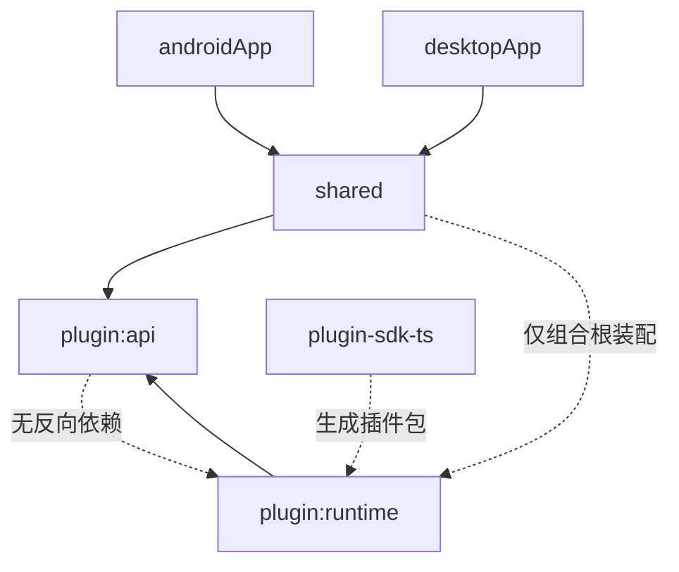
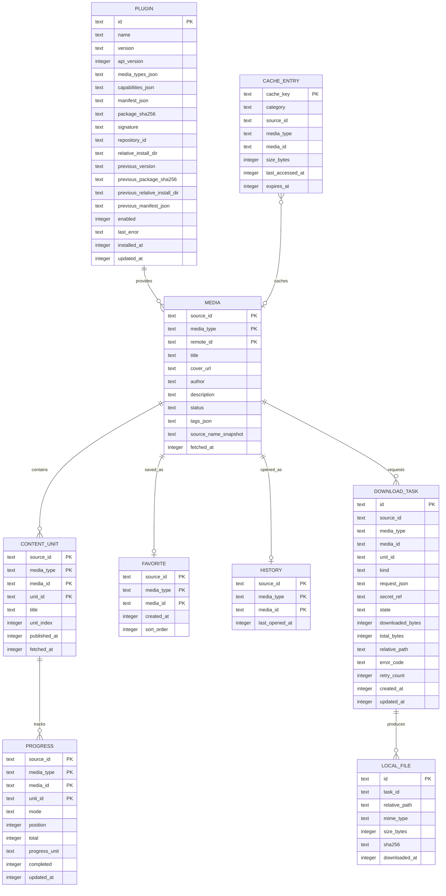

# miyoru 项目结构

> 文档状态：v0.3，已确认（2026-11-05 更新：定名 miyoru；视频离线与本地导入进 P0）  
> 更新时间：2026-11-05  
> 适用对象：开发、测试及后续编码 Agent  
> 关联文档：[项目目标](./PROJECT_GOALS.md)

本文档是实现约束，不是一次性生成所有模块的清单。后续修改代码前应先确认依赖方向、SQLDelight 数据边界和插件安全边界。

## 1. 架构结论

采用：

> **Feature-based 垂直切片 + Clean Architecture 依赖规则 + 渐进式多模块 + 模块化单体。**

必须同时满足：

1. UI 只依赖 Presentation；Presentation 只依赖 Domain；Data 实现 Domain 接口；Domain 不依赖框架和平台。
2. 功能按用户能力垂直切片，而不是全项目按 `ui/domain/data` 横向切三个大模块。
3. 初期只创建有明确边界的少量物理模块；其余用包边界和代码评审约束。出现编译变慢、协作冲突或独立发布需求后再拆。
4. 插件 API、插件运行时从第一天独立，避免 QuickJS/Native 依赖污染领域层。
5. SQLDelight 是唯一数据库方案，不引入 Room，不为数据库引入 KSP。
6. 第三方媒体库只能存在于适配器实现中，不能进入 Domain、UI、插件 API 或数据库实体。

## 2. 已确认架构决策

| 编号 | 决策 | 状态 |
|---|---|---|
| ADR-001 | Android + Desktop 共享 Compose Multiplatform UI | 接受 |
| ADR-002 | 使用官方 KMP Gradle 生成器结构，`shared` 作为共享与 iOS umbrella 模块 | 接受 |
| ADR-003 | 数据库使用 SQLDelight，排除 Room | 接受 |
| ADR-004 | 不为数据库或依赖注入引入 KSP；Koin 仅使用 DSL | 接受 |
| ADR-005 | Feature-based + Clean 依赖方向，渐进式多模块 | 接受 |
| ADR-006 | 第三方 JS 插件使用 QuickJS-KT + 自有 Host API | 接受 |
| ADR-007 | 播放器使用自有 `PlayerFacade`，实现可替换 | 接受 |
| ADR-008 | 下载使用自有 `DownloadEngine`，实现可替换 | 接受 |
| ADR-009 | 内容身份必须包含 `sourceId`，不同源默认不合并 | 接受 |
| ADR-010 | 首版不承诺 Web/Wasm；iOS 待技术验证 | 接受（iOS 部分已被 ADR-011 更新） |
| ADR-011 | 首发覆盖 Android / Windows / macOS / Linux / iOS 五端；iOS 验证前移至 M0，不再延后 | 接受 |
| ADR-012 | QuickJS-KT 升级到 io.github.dokar3:quickjs-kt 1.0.15：1.0.0-alpha13 无中断能力（死循环永久卡死），1.0.15 提供 evaluationTimeoutMillis + interruptEvaluation，验证通过 | 接受 |

修改接受状态的 ADR 必须新增一条记录，说明原因、迁移和回滚，不得直接改历史结论。

## 3. 初期物理结构

项目开始时使用以下结构，足以支持 M0-M2，不需要提前创建全部目标模块：

```text
F:/miyoru/
├── androidApp/
│   └── src/main/kotlin/app/miyoru/android/
├── desktopApp/
│   └── src/main/kotlin/app/miyoru/desktop/
├── iosApp/                            # M0 即加入，与 shared iOS target 同步启用
├── shared/
│   └── src/
│       ├── commonMain/
│       ├── androidMain/
│       ├── jvmMain/                   # 覆盖 Windows / macOS / Linux
│       ├── iosMain/
│       └── commonTest/
├── plugin/
│   ├── api/                         # 稳定纯 Kotlin 插件契约
│   └── runtime/                     # QuickJS-KT、Host API、验证与隔离
├── plugin-sdk-ts/                   # 独立 Node/TypeScript 工具
├── docs/
│   ├── PROJECT_GOALS.md
│   └── PROJECT_STRUCTURE.md
├── gradle/
│   └── libs.versions.toml
├── build.gradle.kts
├── settings.gradle.kts
└── gradlew / gradlew.bat
```

`iosApp/` 在 M0 即加入，与 `shared` 的 iOS target 同步启用。不要为了“结构完整”现在创建大量空模块。

### 3.1 模块职责

| 模块 | 职责 | 禁止 |
|---|---|---|
| `androidApp` | Android 入口、Activity、系统集成、权限、后台任务注册 | 领域逻辑、直接访问 DAO、解析插件 JSON |
| `desktopApp` | Desktop `main`、窗口、文件选择入口、系统集成（覆盖 Windows / macOS / Linux） | 领域逻辑、直接访问 DAO |
| `iosApp` | iOS 入口、SwiftUI 集成、权限、后台任务注册 | 领域逻辑、直接访问 DAO、解析插件 JSON |
| `shared` | Compose App、导航、DI 组合根、Domain、Data、Feature、平台 expect/actual | 暴露 QuickJS 类型到 UI/Domain |
| `plugin:api` | 插件清单、能力、DTO、`PluginEngine`/Host 接口、稳定错误协议 | Compose、Ktor、QuickJS、SQLDelight、Android Context |
| `plugin:runtime` | QuickJS 生命周期、宿主 HTTP/HTML、权限、超时、输出校验 | Compose、DAO、直接修改用户库 |
| `plugin-sdk-ts` | TypeScript 类型、esbuild 打包、清单校验、测试工具 | 运行时依赖 Node 内置模块的插件代码 |

### 3.2 依赖方向



- `shared` 的 UI、Domain、Data 代码只引用 `plugin:api`。
- 只有 `shared` 的 DI/组合根可以引用 `plugin:runtime` 并提供 `PluginEngine`。
- `plugin:runtime` 不依赖 `shared`，它通过 `plugin:api` 中的接口和配置工作，避免循环依赖。
- 平台 App 模块只依赖 `shared`。平台专属能力通过 `shared` 暴露的最小接口注入。

## 4. 构建与 Source Set

- 使用 Gradle Kotlin DSL 和 `gradle/libs.versions.toml`；版本只在版本目录维护。
- 使用官方 KMP 生成器当前的 Android KMP Library 插件，不使用旧教程的 Android-only library 配置。
- `shared` target 初始即为 `androidLibrary`、`jvm()`（覆盖 Windows / macOS / Linux）、`iosArm64()`、`iosSimulatorArm64()` 和静态 umbrella framework。
- 不新增 `iosX64`、32 位目标或未经验证的 Web target。
- 参考基线：Android minSdk 24、compileSdk/targetSdk 37、JDK 17+；iOS 以 Xcode 正式版 + 受支持的双架构模拟器/真机为准；最终以生成器的兼容组合为准，升级前运行全部平台冒烟测试。
- 桌面默认 JetBrains Runtime/JDK 17+，并加入 `kotlinx-coroutines-swing`，确保 `Dispatchers.Main` 与 ViewModel 正常。
- Source set 只放真正平台相关的实现：

| Source set | 允许内容 |
|---|---|
| `commonMain` | Domain、UI、Presentation、SQLDelight Schema/Query、插件抽象、通用 Data |
| `androidMain` | Android SQLite Driver、Context 路径、Keystore、WorkManager、Media3 底层配置 |
| `jvmMain` | JDBC SQLite Driver、桌面路径、OS 密钥存储、后台服务、MPV/MediaMP 底层配置 |
| `iosMain` | Native SQLite Driver、Keychain、后台任务、AVKit 配置 |
| `commonTest` | Domain/UseCase/Presentation 测试、假 Repository、SQLDelight 迁移 fixture 验证辅助 |
| 平台 Test | Driver、文件路径、平台播放器、后台任务集成测试 |

不要在 `commonMain` 中使用 `java.io.File`、`android.content.Context`、`NSFileManager`、`ExoPlayer`、`MPVHandle` 或 QuickJS 原生类型。

## 5. `shared` 的包结构

包名为 `app.miyoru`。包结构保持稳定，物理模块后续再拆。

```text
shared/src/commonMain/kotlin/app/miyoru/
├── App.kt
├── di/
│   ├── AppModules.kt
│   └── PlatformDependencies.kt
├── navigation/
│   ├── AppRoute.kt
│   ├── AppNavHost.kt
│   └── TopLevelDestination.kt
├── core/
│   ├── common/
│   │   ├── AppDispatchers.kt
│   │   ├── AppError.kt
│   │   ├── AppResult.kt
│   │   ├── ClockProvider.kt
│   │   └── Logger.kt
│   ├── model/
│   │   ├── MediaKey.kt
│   │   ├── MediaType.kt
│   │   ├── Page.kt
│   │   └── SourceId.kt
│   ├── network/
│   │   ├── HttpClientFactory.kt
│   │   └── NetworkConfig.kt
│   ├── database/
│   │   ├── DatabaseFactory.kt
│   │   ├── DatabaseDriverFactory.kt
│   │   └── DatabaseMappers.kt
│   ├── datastore/
│   │   ├── SettingsDataStore.kt
│   │   └── DataStoreFactory.kt
│   ├── filesystem/
│   │   ├── AppFileStore.kt
│   │   └── CacheStore.kt
│   └── ui/
│       ├── theme/
│       ├── components/
│       └── state/
├── domain/
│   ├── source/
│   │   ├── model/
│   │   │   ├── SourceInfo.kt
│   │   │   ├── MediaSummary.kt
│   │   │   ├── MediaDetail.kt
│   │   │   ├── ContentUnit.kt
│   │   │   ├── ResolvedContent.kt
│   │   │   └── StreamResource.kt
│   │   ├── repository/
│   │   │   └── SourceRepository.kt
│   │   └── usecase/
│   │       ├── SearchAcrossSources.kt
│   │       └── ResolveContent.kt
│   ├── plugin/
│   │   ├── model/
│   │   │   ├── InstalledPlugin.kt
│   │   │   └── PluginUpdate.kt
│   │   ├── repository/
│   │   │   └── PluginRepository.kt
│   │   └── usecase/
│   │       ├── InstallPlugin.kt
│   │       └── RollbackPlugin.kt
│   ├── library/
│   │   ├── model/
│   │   │   ├── Favorite.kt
│   │   │   ├── HistoryEntry.kt
│   │   │   └── MediaProgress.kt
│   │   ├── repository/
│   │   │   └── LibraryRepository.kt
│   │   └── usecase/
│   │       └── UpdateProgress.kt
│   └── download/
│       ├── model/
│       │   ├── DownloadTask.kt
│       │   ├── DownloadStatus.kt
│       │   └── DownloadRequest.kt
│       ├── repository/
│       │   └── DownloadRepository.kt
│       └── usecase/
│           └── EnqueueDownload.kt
├── data/
│   ├── source/
│   │   ├── SourceRepositoryImpl.kt
│   │   ├── PluginSourceGateway.kt
│   │   ├── SourceSnapshotStore.kt
│   │   └── mapper/
│   ├── plugin/
│   │   ├── PluginRepositoryImpl.kt
│   │   ├── PluginPackageInstaller.kt
│   │   ├── PluginSignatureVerifier.kt
│   │   ├── PluginRepositoryClient.kt
│   │   └── mapper/
│   ├── library/
│   │   ├── LibraryRepositoryImpl.kt
│   │   └── mapper/
│   ├── download/
│   │   ├── DownloadRepositoryImpl.kt
│   │   └── mapper/
│   ├── database/
│   │   ├── MiyoruDatabaseFactory.kt
│   │   └── queries/
│   └── settings/
│       └── SettingsRepositoryImpl.kt
├── feature/
│   ├── home/
│   │   ├── ui/
│   │   └── presentation/
│   ├── search/
│   │   ├── ui/
│   │   └── presentation/
│   ├── detail/
│   │   ├── ui/
│   │   └── presentation/
│   ├── library/
│   │   ├── ui/
│   │   └── presentation/
│   ├── novelreader/
│   │   ├── ui/
│   │   ├── presentation/
│   │   └── domain/              # 仅在存在真实阅读规则时创建
│   ├── comicreader/
│   │   ├── ui/
│   │   ├── presentation/
│   │   └── domain/
│   ├── videoplayer/
│   │   ├── ui/
│   │   ├── presentation/
│   │   └── domain/
│   ├── downloads/
│   │   ├── ui/
│   │   └── presentation/
│   ├── pluginmanager/
│   │   ├── ui/
│   │   └── presentation/
│   └── settings/
│       ├── ui/
│       └── presentation/
└── platform/
    ├── player/
    │   ├── PlayerFacade.kt
    │   └── PlaybackState.kt
    ├── download/
    │   └── DownloadEngine.kt
    ├── security/
    │   └── SecretStore.kt
    ├── background/
    │   └── BackgroundTaskScheduler.kt
    └── system/
        └── SystemInfo.kt
```

对应平台实现放在 `androidMain`、`jvmMain`、`iosMain` 的同一包路径下。`shared` 不创建 `ui`、`presentation`、`domain`、`data` 四个顶层大模块。

### 5.1 Feature 内部规则

- `ui`：Screen、可复用局部组件、预览；只接收 `UiState` 和事件 lambda。
- `presentation`：ViewModel、`UiState`、`UiAction`/`UiEvent`；不导入 Compose UI，不持有 `Context`。
- `feature/*/domain`：仅放该 Feature 特有规则，例如漫画翻页方向、小说位置换算、视频续播策略。简单页面不得创建空 `UseCase` 或空 Domain 包。
- Feature 之间不能直接导入对方的 `ui` 或 `presentation` 实现。通过 App 导航传递 ID 和回调。
- Feature 共用模型放在 `domain`，共用 UI 放在 `core/ui`；不要创建 `common` 万能包。
- 如果 Feature 需要其他 Feature 的行为，优先通过 Domain 服务或 App 导航解决，而不是交叉依赖。

### 5.2 依赖约束

```text
feature/ui ──→ feature/presentation ──→ domain
      │                    │
      └──→ core/ui        └──→ core/common

data ──→ domain
data ──→ plugin/api、core/database、core/network、core/filesystem
platform 实现 ←── 仅在组合根注入

app/navigation ──→ 所有 feature（只负责组装）
```

禁止：

- Domain 导入 Compose、Room/SQLDelight、Ktor、QuickJS、Coil、MediaMP、Ketch、FileKit、Koin。
- UI 导入 SQLDelight 生成类、DTO、`PluginEngine`、`PlayerFacade` 的平台实现。
- Data 将 SQLDelight Row、Plugin DTO 或 Ktor Response 直接返回 Domain/UI。
- Feature 直接调用 `PluginEngine`；统一经 `SourceRepository`。
- 插件 JS 直接触达 SQLite、文件或播放器。

## 6. 数据模型

### 6.1 身份

```kotlin
@JvmInline value class SourceId(val value: String)
@JvmInline value class RemoteId(val value: String)

enum class MediaType { VIDEO, NOVEL, COMIC }

data class MediaKey(
    val sourceId: SourceId,
    val mediaType: MediaType,
    val remoteId: RemoteId,
)
```

- `ContentUnitKey` 在 `MediaKey` 上增加 `unitId`。
- 媒体和章节主键必须包含源 ID 与媒体类型。
- 不同源同名内容默认独立；跨源合并只能是 P1 的显式 `Work` 关系，不得用标题自动合并。
- UI 导航路由只传 ID 字段，不传完整领域对象。

### 6.2 Domain 模型

```kotlin
data class MediaSummary(
    val key: MediaKey,
    val title: String,
    val coverUrl: String?,
    val author: String?,
    val description: String?,
    val status: String?,
    val tags: List<String> = emptyList(),
)

data class MediaDetail(
    val summary: MediaSummary,
    val sourceName: String,
    val attributes: Map<String, String> = emptyMap(),
)

data class ContentUnit(
    val key: ContentUnitKey,
    val title: String,
    val index: Long,
    val publishedAt: Long? = null,
)

sealed interface ResolvedContent {
    data class Novel(val text: String) : ResolvedContent
    data class Comic(val pages: List<ImageResource>) : ResolvedContent
    data class Video(val streams: List<StreamResource>) : ResolvedContent
}

data class ImageResource(
    val url: String,
    val headers: Map<String, String> = emptyMap(),
    val mimeType: String? = null,
    val expiresAt: Long? = null,
)

data class StreamResource(
    val url: String,
    val headers: Map<String, String> = emptyMap(),
    val mimeType: String? = null,
    val qualityLabel: String? = null,
    val subtitles: List<SubtitleTrack> = emptyList(),
    val expiresAt: Long? = null,
)
```

- `headers`、临时 URL 属于短期资源，只存在内存或受控缓存，不写普通日志。
- `ResolvedContent` 不进入 SQLDelight；正文/图片/视频流按缓存策略保存。
- UI 使用的 `UiState` 与 Domain 模型分开。不要为了“层数”复制所有字段；只在边界需要时转换。

### 6.3 错误模型

```kotlin
sealed class AppError(message: String?, cause: Throwable? = null) : Exception(message, cause) {
    data class Network(override val cause: Throwable) : AppError("网络请求失败", cause)
    data class Timeout(val operation: String) : AppError("操作超时")
    data class Parse(val detail: String) : AppError("数据解析失败")
    data class Authentication(val sourceId: String) : AppError("源需要登录或凭据失效")
    data class RateLimited(val retryAfterSeconds: Long?) : AppError("请求过于频繁")
    data class CapabilityUnsupported(val capability: String) : AppError("源不支持该能力")
    data class PluginIncompatible(val pluginId: String, val reason: String) : AppError("插件版本不兼容")
    data class Storage(override val cause: Throwable) : AppError("本地存储失败", cause)
    data class InvalidInput(val detail: String) : AppError("输入不合法")
    data object PermissionDenied : AppError("权限不足")
}
```

- 每个错误必须有稳定错误码供日志和插件开发者定位；可另建 `ErrorCode` 枚举或字符串常量。
- 协程取消必须重新抛出 `CancellationException`，不得转成普通错误或展示给用户。
- 不向用户展示原始 HTML、堆栈或完整 URL。

## 7. SQLDelight 设计

### 7.1 固定约束

- 数据库框架：`app.cash.sqldelight`，数据库名 `MiyoruDatabase`，包名 `app.miyoru.db`。
- 不使用 Room、`androidx.room`、Room3 或与数据库相关的 KSP/KAPT。
- Koin 只用 runtime DSL，不使用 Koin Annotations/KSP。
- 不直接手改 SQLDelight 生成代码。
- UI/Domain 不导入 `app.miyoru.db.*` 生成类。
- 数据库文件路径由平台 `DatabaseDriverFactory` 提供，common 层只依赖接口。
- 不启用 destructive migration 作为正常升级方案。
- 下载完成文件、缓存和数据库备份需要区别管理，不能仅靠数据库事务保证原子性。

### 7.2 文件位置

```text
shared/src/commonMain/sqldelight/
├── app/miyoru/db/
│   ├── Plugin.sq
│   ├── Media.sq
│   ├── ContentUnit.sq
│   ├── Library.sq
│   ├── Download.sq
│   ├── Cache.sq
│   └── migrations/
│       └── 1.sqm                 # 首次 Schema 变更时创建
└── databases/
    └── 1.db                      # generate schema 产物，用于迁移验证
```

- `.sq` 始终描述最新 Schema 与查询。
- 迁移文件命名为 `<旧版本>.sqm`；升级到版本 2 使用 `1.sqm`。
- 配置 `schemaOutputDirectory`，在第一次迁移前生成初始 `1.db`。
- CI 必须执行 SQLDelight 迁移验证；发布前在旧数据库副本上做升级测试。
- Schema 变化与迁移文件必须同一个变更提交。

### 7.3 表设计



实现要求：

- 主键、索引在 `.sq` 中显式定义，常用查询至少覆盖 `media(title)`、`content_unit(media id)`、`history(last_opened_at)`、`download_task(state)`、`cache_entry(last_accessed_at)`。
- 枚举存稳定字符串或经集中 ColumnAdapter 转换；不要依赖序号。
- 时间统一 epoch milliseconds；展示层再格式化。
- JSON 列只用于标签、能力等非主查询字段；不要把整个领域对象塞进单个 JSON。
- `FAVORITE`、`HISTORY`、`PROGRESS` 不因插件卸载而级联删除；删除插件只清理插件配置与凭据。
- P0 只保证一层版本回滚：`previous_*` 字段保存上一版本；成功更新时把旧当前版本转为 previous，回滚时交换两套值，文件目录同步原子切换。
- 插件安装、回滚和删除必须先完成文件系统操作并确认结果，再提交数据库终态；崩溃恢复时以数据库状态和暂存目录清单做对账。
- `DOWNLOAD_TASK.request_json` 只保存非敏感的稳定选择器（源、媒体、章节、资源类型等），不保存最终临时 URL。
- `DOWNLOAD_TASK.secret_ref` 只保存平台安全存储的引用；敏感 Header/Cookie/Token 不得明文写入 SQLite 或日志。恢复任务时优先重新调用插件解析 URL，解析失败则把任务置为明确的可重试错误。
- 仅当下载 URL 稳定且不含敏感查询参数时才允许保存 URL；其他情况必须通过插件重新解析或使用加密存储。
- `LOCAL_FILE.relative_path` 和 `PLUGIN.relative_install_dir` 必须相对应用数据根目录，避免应用目录移动后失效。
- 缓存与下载分开：缓存可淘汰，下载不能被自动清理。
- P1 全文搜索可通过 SQLite FTS 表或迁移加入；在驱动验证前不要假设所有平台 FTS 可用。

### 7.4 Driver 与数据库打开

在 `commonMain` 定义接口，平台分别提供实际 Driver：

```kotlin
interface DatabaseDriverFactory {
    fun createDriver(): SqlDriver
}

interface DatabaseFactory {
    fun create(): MiyoruDatabase
}
```

- Android actual：应用数据库目录 + `AndroidSqliteDriver`。
- JVM actual：应用数据目录 + `JdbcSqliteDriver`，不得使用系统临时目录。
- iOS actual：应用文档/支持目录 + `NativeSqliteDriver`。
- 数据库路径通过 `AppFileStore` 或平台依赖注入，不能在 common 层拼文件路径。
- 查询使用 SQLDelight 协程扩展时显式指定 `Dispatchers.IO` 或注入的数据库 dispatcher，不阻塞主线程。
- 数据库初始化失败必须阻止进入“已就绪”主界面并给出修复/导出日志入口，不能静默使用内存数据库。

## 8. Repository 与数据流

### 8.1 Domain 接口

```kotlin
interface SourceRepository {
    fun observeSources(): Flow<List<SourceInfo>>
    suspend fun search(sourceId: SourceId, type: MediaType, query: String, cursor: String?): Page<MediaSummary>
    suspend fun detail(key: MediaKey): MediaDetail
    suspend fun contentUnits(key: MediaKey): List<ContentUnit>
    suspend fun resolve(unitKey: ContentUnitKey): ResolvedContent
}

interface LibraryRepository {
    fun observeFavorites(type: MediaType? = null): Flow<List<MediaSummary>>
    fun observeHistory(limit: Int = 100): Flow<List<HistoryEntry>>
    fun observeProgress(key: MediaKey, unitId: RemoteId): Flow<MediaProgress?>
    suspend fun toggleFavorite(key: MediaKey)
    suspend fun saveProgress(progress: MediaProgress)
    suspend fun removeHistory(key: MediaKey)
}

interface PluginRepository {
    fun observeInstalled(): Flow<List<InstalledPlugin>>
    suspend fun install(source: PluginPackageSource, expectedSha256: String? = null)
    suspend fun setEnabled(pluginId: String, enabled: Boolean)
    suspend fun checkForUpdate(pluginId: String): PluginUpdate?
    suspend fun update(pluginId: String): InstalledPlugin
    suspend fun rollback(pluginId: String): InstalledPlugin
    suspend fun uninstall(pluginId: String)
}

interface DownloadRepository {
    fun observeTasks(): Flow<List<DownloadTask>>
    suspend fun enqueue(request: DownloadRequest): String
    suspend fun pause(taskId: String)
    suspend fun resume(taskId: String)
    suspend fun cancel(taskId: String)
    suspend fun remove(taskId: String, deleteFiles: Boolean)
}
```

- `PluginPackageSource` 表示用户选择的 URL 或本地文件，Domain 不持有平台文件对象。
- `PluginRepositoryImpl` 负责安装事务和调用 `PluginPackageInstaller`；`PluginEngine` 不负责安装、启用或修改数据库。
- `MediaDetail` 不携带完整章节列表；章节通过 `contentUnits()` 单独获取，避免超大目录拖慢详情首屏。

`SearchAcrossSources` 负责并行执行、单源超时、部分成功与合并状态。实现规则：

- 使用 `supervisorScope` 或每个源独立捕获的非取消异常。
- 结果按源分组，保留每个源的成功、空结果、失败和耗时。
- 新搜索取消旧搜索；离开页面取消全部子任务。
- 不因一个源失败而返回全局失败。
- 单源结果不得阻塞其他源 UI 呈现；是否流式展示由 Presentation 决定。

### 8.2 数据流

```text
用户操作
  → Composable 发出 Event
  → ViewModel 调用 UseCase/Repository
  → SourceRepositoryImpl 调用 PluginEngine
  → Plugin JSON → DTO → Schema/业务校验 → Domain Mapper
  → 保存快照/缓存（按需）
  → Flow/UiState
  → Compose 渲染
```

- 所有插件结果先验证再映射，不得直接把 JS JSON 当 Domain 对象。
- 远程结果可以在写入缓存前返回 UI，但本地媒体库操作必须有明确持久化结果。
- Repository 是数据一致性的唯一边界；ViewModel 不访问数据库或插件引擎。
- 远程细节失败时，收藏/历史可使用本地快照降级展示，并标记“数据可能已过期”。
- 网络刷新与本地写入发生的错误用同一 `AppError` 映射，保留技术原因但不泄露敏感数据。

## 9. 插件系统结构

### 9.1 `plugin:api`

只允许依赖 Kotlin 标准库、coroutines、kotlinx.serialization：

```text
plugin/api/src/commonMain/kotlin/app/miyoru/plugin/api/
├── PluginManifest.kt
├── PluginCapability.kt
├── PluginMediaType.kt
├── PluginRequest.kt
├── PluginResponse.kt
├── PluginError.kt
├── PluginEngine.kt
└── HostServices.kt
```

`PluginEngine` 只暴露稳定的生命周期和调用，不暴露 QuickJS 对象：

```kotlin
interface PluginEngine {
    suspend fun createSession(pluginId: String, entrySource: String): PluginSession
    suspend fun close(pluginId: String)
}

interface PluginSession {
    suspend fun invoke(call: PluginCall): PluginResult
    suspend fun close()
}
```

`PluginEngine` 只负责执行，不负责 ZIP 安装、启用、更新或写数据库。具体签名可在实现时调整，但必须保持：输入输出 JSON 可序列化、支持取消、错误可分类、不得返回引擎内部对象。

### 9.2 `plugin:runtime`

```text
plugin/runtime/src/
├── commonMain/kotlin/app/miyoru/plugin/runtime/
│   ├── QuickJsPluginEngine.kt
│   ├── PluginRuntimeFactory.kt
│   ├── PluginScriptLoader.kt
│   ├── PluginInvocationScheduler.kt
│   ├── PluginResultValidator.kt
│   ├── host/
│   │   ├── HostHttpService.kt
│   │   ├── HostHtmlService.kt
│   │   ├── HostCookieService.kt
│   │   ├── HostCryptoService.kt
│   │   └── HostLogService.kt
├── androidMain/
├── jvmMain/                          # 覆盖 Windows / macOS / Linux
└── iosMain/
```

运行时规则：

- 每个插件使用独立 QuickJS 实例和单线程调度器；同一插件调用串行，不同插件可有限并发。
- M0/M1 允许同进程隔离，但 API 不得暴露“必定同进程”的假设；面向公开插件仓库前必须评估 Android 独立进程或桌面 sidecar。
- 单次 JS 执行有硬超时、协程取消和手动中断；超时映射为 `AppError.Timeout`。
- 宿主 HTTP 的域名、协议、重定向、请求次数、请求体/响应体大小都在运行时强制校验。
- HTTP Cookie Jar 按插件隔离；插件卸载清理对应 Cookie 与缓存。
- 宿主 HTML 解析通过 Ksoup 封装，返回简单可序列化结果；不暴露 Jsoup/Ksoup 节点对象。
- JS 结果必须有 JSON Schema/手写 validator 校验，并限制嵌套深度、数组长度、字符串长度和总字节数。
- 不通过 JS 传输图片、视频或大文件，只传 URL/Header/元数据；媒体下载由原生 Data 层完成。
- 不执行远程预编译 QuickJS bytecode；仅执行插件 ZIP 内声明的源码 bundle，编译缓存与引擎版本绑定。
- 运行时不直接读写用户数据库；需要缓存时由 `shared` Data 层负责。

### 9.3 插件包

```text
plugin.zip
├── manifest.json
├── bundle.js
└── icon.png
```

`manifest.json` 的最小字段：

```json
{
  "id": "example.source",
  "name": "Example Source",
  "version": "1.0.0",
  "apiVersion": 1,
  "minAppVersion": "0.1.0",
  "author": "Example",
  "homepage": "https://example.com",
  "mediaTypes": ["novel", "comic"],
  "capabilities": ["home", "search", "detail", "chapters", "pages"],
  "permissions": {
    "domains": ["https://example.com"]
  },
  "entry": "bundle.js",
  "entrySha256": "<bundle.js 的 SHA-256>",
  "signature": null
}
```

- `bundle.js` 使用 ES Modules/IIFE 的单一产物，不依赖 Node 内置模块、DOM 或 `require`。
- 插件只导出 manifest 声明过的能力函数；未声明能力被调用时返回 `CapabilityUnsupported`。
- `entrySha256` 校验 ZIP 内入口文件；整个 ZIP 的 `packageSha256` 由仓库索引提供或安装时计算并写入数据库，避免 manifest 对自身哈希产生循环依赖。
- `signature` 是发布者对“不含 `signature` 字段的规范化 manifest”的 Ed25519 签名，Base64 编码；签名校验必须使用规范化字节序列。
- 开发模式允许未签名 ZIP，但必须在 UI 显示高风险提示和本地指纹；Release 始终校验完整性与兼容性，并按每个源仓库配置决定是否强制发布者签名。
- 安装流程：暂存目录 → 解压安全检查（无路径穿越/符号链接）→ 清单校验 → 入口哈希/可选签名校验 → 与仓库索引比对包哈希 → 兼容性检查 → 原子替换 → 记录 DB。失败保留旧版本。
- 更新默认需要用户确认；自动检查只获取元数据，不静默替换执行代码。
- 插件日志按 `pluginId + sessionId` 标记，写入前脱敏。

### 9.4 源仓库索引

应用不内置正式源仓库。用户添加仓库 URL 后，应用只负责获取索引、展示来源并校验安装包：

```json
{
  "schemaVersion": 1,
  "repositoryId": "example.repository",
  "name": "Example Repository",
  "generatedAt": 1790000000000,
  "plugins": [
    {
      "id": "example.source",
      "version": "1.0.0",
      "apiVersion": 1,
      "mediaTypes": ["novel"],
      "downloadUrl": "https://example.com/plugins/example-source-1.0.0.zip",
      "packageSha256": "<zip sha256>",
      "minAppVersion": "0.1.0"
    }
  ]
}
```

- 仓库索引和插件包必须通过 HTTPS；`downloadUrl` 每一跳重新校验域名、协议和重定向。
- 索引 SHOULD 提供分离签名 `repository.json.sig`；公钥由用户添加仓库时确认或通过可信渠道预置。
- 仓库只能提供元数据和包，不得指定应用行为、插件安装路径或宿主权限之外的设置。
- 索引缓存属于可清理数据；断网时可以使用最后一次已验证的索引，但更新操作必须重新验证。
- 同一个插件 `id` 的降级、版本回滚和来源切换必须由用户确认，防止仓库劫持。

### 9.5 插件开发 SDK

`plugin-sdk-ts` 独立于 Gradle 构建：

```text
plugin-sdk-ts/
├── package.json
├── tsconfig.json
├── src/
│   ├── types/
│   │   ├── manifest.ts
│   │   ├── host.ts
│   │   └── source.ts
│   ├── cli/
│   │   ├── init.ts
│   │   ├── build.ts
│   │   ├── validate.ts
│   │   └── pack.ts
│   └── testing/
│       └── fake-host.ts
├── examples/                      # 仅测试/示例，不放正式源
└── test/
```

- 使用 TypeScript + esbuild 生成单文件 bundle，输出 manifest 与图标 ZIP。
- Node 版本在 `.nvmrc`/`package.json engines` 固定为当前 LTS，不把 Node 运行时带入客户端。
- 单元测试使用 Vitest；不得在 SDK 默认 fixture 中硬编码真实站点解析规则。
- `plugin-sdk-ts` 的 `apiVersion` 必须与 `plugin:api` 的合同一致；升级 API 时同时修改 TypeScript 类型、Kotlin DTO 和契约测试。

## 10. 播放与下载边界

### 10.1 PlayerFacade

```kotlin
interface PlayerFacade {
    val state: StateFlow<PlaybackState>
    suspend fun prepare(stream: StreamResource)
    fun play()
    fun pause()
    fun seekTo(positionMillis: Long)
    fun setSpeed(speed: Float)
    fun release()
}
```

- UI/ViewModel 只操作 `PlayerFacade`，不导入 MediaMP、Media3、MPV、AVKit 类型。
- `MediaMP` 是首要评估实现；桌面使用 MPV 后端，不重新引入 VLC。
- 自定义请求头、Cookie、HLS、字幕和音轨能力在 M0 做技术验证；任何不支持的路径都要在 Facade 中显式降级。
- 流 URL 过期时由 `ResolveContent` 重新请求；不要持久化到播放器状态。
- 播放器实现放在平台 source set，Compose 控制层共用；原生 Surface 通过 platform view interop 接入。
- 错误必须映射为加载、需要重新解析、源不支持、网络失败、解码失败等可展示状态。

### 10.2 DownloadEngine

```kotlin
interface DownloadEngine {
    fun enqueue(request: DownloadRequest): Flow<DownloadEvent>
    suspend fun pause(taskId: String)
    suspend fun resume(taskId: String)
    suspend fun cancel(taskId: String)
}
```

- P0 负责小说/漫画/视频资源、普通 HTTP 文件与 HLS/DASH 基础离线（含清晰度选择）；独立音轨合并等高级离线选项属于 P1。
- `DownloadRepository` 管任务状态和文件索引，`DownloadEngine` 只管执行；`enqueue` 返回的 Flow 只用于观察任务，取消订阅不得取消已入队任务，必须调用 `cancel`。
- `DownloadRequest` 必须包含非敏感选择器和可选 `secretRef`；执行前重新解析临时 URL，不能依赖已过期链接继续恢复。
- Android 长任务使用前台服务/WorkManager 组合；桌面使用应用级 scope 与明确的退出策略；iOS 使用平台后台下载能力。
- 应用重启后从数据库恢复可恢复任务；不假设所有平台都能在进程被杀后保持网络连接。
- 下载文件先写 `.part` 临时文件，校验后原子改名；数据库写入和文件完成状态要有一致性修复流程。
- 凭据/Header 从安全存储按任务读取，不写普通数据库或日志。
- 删除下载时必须先停止任务，再删文件并更新数据库；失败要可重试，不能留下“已完成但文件不存在”的假状态。

## 11. 导航、状态与依赖注入

### 11.1 导航

使用稳定版 Compose Navigation，类型安全路由只包含可序列化 ID：

```kotlin
@Serializable
data class DetailRoute(
    val sourceId: String,
    val mediaType: String,
    val remoteId: String,
)

@Serializable
data class NovelReaderRoute(
    val sourceId: String,
    val remoteId: String,
    val unitId: String? = null,
)
```

- 路由定义在 `navigation/AppRoute.kt`；Feature 暴露 `Screen` 和事件回调，不直接操作全局 `NavController`。
- 不传完整 `MediaDetail`、图片列表或播放器对象。
- 阅读器/播放器进入独立 destination；返回时保存进度。
- Android 系统返回、桌面键盘返回和 URL/Deep Link（P1）应共享同一导航语义。
- Navigation 3 可评估，但升级必须保持 ViewModel scoping、返回栈和桌面行为一致；首版不作为强制依赖。

### 11.2 Presentation 状态

```kotlin
data class SearchUiState(
    val query: String = "",
    val isSearching: Boolean = false,
    val groups: List<SourceResultUi> = emptyList(),
    val selectedType: MediaType = MediaType.NOVEL,
    val errorMessage: String? = null,
)

data class SourceResultUi(
    val sourceName: String,
    val items: List<MediaSummary> = emptyList(),
    val isLoading: Boolean = false,
    val error: String? = null,
)
```

- 使用不可变 `UiState` + `StateFlow`，UI 用 `collectAsStateWithLifecycle`。
- 一次性导航、Toast、分享等副作用使用 `Channel`/`SharedFlow`，不要塞进持久 `UiState`。
- ViewModel 接收用例/仓储接口，不接收 `NavController`、`Context` 或 Compose 对象。
- 搜索输入可使用 debounce；取消旧请求；结果按源保留部分成功状态。
- 页面初次加载、刷新、空数据、局部错误和全局错误必须是不同状态，不能只用一个布尔值。

### 11.3 Koin DSL

```kotlin
val appModule = module {
    single<SourceRepository> { SourceRepositoryImpl(get(), get(), get()) }
    single<LibraryRepository> { LibraryRepositoryImpl(get()) }
    single<PluginEngine> { get<PluginRuntimeFactory>().create() }
    viewModel { SearchViewModel(get(), get()) }
}
```

- 只用 Koin DSL；不引入 Koin Annotations/KSP。
- DI 组合根位于 `shared/di`，平台依赖通过 `PlatformDependencies` 显式传入 `App`。
- Domain 不添加 Koin 注解；Data 构造函数注入接口。
- 单例只用于无状态服务、数据库、HTTP 客户端和配置；ViewModel、页面状态不可单例。
- 测试使用手工 fake 优先，不启动完整 DI 容器。

## 12. 并发与生命周期

- 禁止 `GlobalScope`、无限期 `runBlocking`、在主线程执行 SQL/IO/JS。
- ViewModel 使用 `viewModelScope`；应用级任务使用受控 `AppScope`（`SupervisorJob` + 注入 dispatcher）。
- `Dispatchers` 通过 `AppDispatchers` 注入，测试可替换；不要在每个类里硬编码 `Dispatchers.IO`。
- 全局搜索、批量刷新使用结构化并发；子任务失败不影响同级其他任务，但取消必须传播。
- QuickJS 实例有固定单线程 dispatcher；关闭页面或禁用插件时取消并释放。
- 数据库事务要短；下载和网络请求不持有数据库事务。
- 进度保存进行节流：播放/阅读中最多每 5 秒写一次，页面离开与暂停时立即写。
- 生命周期监听在 common 层使用官方 Lifecycle API；桌面补 `kotlinx-coroutines-swing`。
- App 进入后台/桌面窗口失焦时按平台策略暂停播放、下载通知和高频 UI 更新。

## 13. 文件、缓存和平台能力

- 高层文件选择、保存和应用目录通过 `AppFileStore` 接口暴露，默认实现可使用 FileKit。
- 业务代码只依赖接口和相对路径；数据库不保存平台绝对路径。
- 缓存根目录、下载根目录、日志目录和临时目录由平台依赖提供，读取前检查可用空间。
- 缓存键由内容身份/URL 的稳定哈希组成，不把完整签名 URL 作为文件名。
- 图片请求必须支持按源注入 Header/Cookie；Coil 请求头实现方式需在 M0 验证并集中到 `ImageRequestFactory`。
- 密钥、Cookie 与 Token 通过 `SecretStore`；Android Keystore、iOS Keychain、桌面平台安全存储分别实现。
- 日志使用统一 Logger 接口，Release 默认只保留结构化错误摘要，不记录正文、Cookie 和完整查询字符串。
- 后台任务、通知、存储权限、网络权限只由平台 App 模块处理，Domain 不出现权限 API。

## 14. 测试结构

```text
shared/src/commonTest/kotlin/app/miyoru/
├── domain/source/SearchAcrossSourcesTest.kt
├── domain/library/UpdateProgressTest.kt
├── data/source/SourceRepositoryImplTest.kt
├── feature/search/SearchViewModelTest.kt
└── fixtures/

shared/src/jvmTest/kotlin/app/miyoru/
├── database/DatabaseMigrationTest.kt
├── database/QuerySmokeTest.kt
└── filesystem/AppFileStoreTest.kt

plugin/runtime/src/jvmTest/kotlin/app/miyoru/plugin/runtime/
├── QuickJsRuntimeTest.kt
├── PluginValidationTest.kt
└── HostPermissionTest.kt

plugin-sdk-ts/test/
├── manifest.test.ts
├── bundle.test.ts
└── fake-host.test.ts
```

测试要求：

- Domain/UseCase 测试覆盖成功、空结果、部分失败、超时、取消和进度边界。
- 每个 SQLDelight 迁移必须在旧 Schema 数据库上验证；不能只测“新建数据库”。
- Repository 使用内存 SQLite/JDBC Driver 或测试数据库，不依赖生产路径。
- 插件运行时测试必须包含：死循环超时、取消、非法 JSON、超大结果、跨域请求、重定向到私网、Cookie 隔离。
- UI 测试使用 Fake Repository 和固定状态；Compose 截图测试可选，不作为唯一验证。
- 禁止 CI 依赖真实外网站点。使用本地 Mock HTTP Server 和固定 HTML/JSON fixture。
- 测试插件只放在 Debug/test fixture，Release 包不打包真实源。

## 15. 编码规范

- Kotlin 使用官方代码风格，包名小写，类名 PascalCase，函数/属性 camelCase。
- 优先 `val`、不可变数据、显式错误类型；避免 `!!`、隐式全局状态、可变单例。
- 公共 API 保持小；实现默认可 `internal`，不要无意义地将所有类暴露为 public。
- 接口不加 `I` 前缀；实现以 `Impl` 或具体技术命名，如 `SqlDelightLibraryRepository`。
- SQLDelight 表/列使用 `snake_case`，查询命名描述业务意图，如 `selectRecentHistory`。
- DTO 以 `Dto`/`Plugin...` 命名，数据库生成类型不进入 Domain，Mapper 放 `data/*/mapper`。
- Compose 不在 Composable 中直接发起网络/数据库调用；通过 ViewModel 事件。
- 不硬编码用户可见文案，使用 Compose Resources；错误信息可本地化。
- 注释解释“为什么”和边界，不重复代码；公共安全逻辑要有 KDoc。
- 日志使用结构化字段，禁止 `println`、输出 Cookie、Authorization、正文和完整 URL。
- 所有新依赖必须说明用途、维护状态、目标平台和安全影响；不能为了少写几十行引入大型框架。
- 任何新增真实源、脚本地址或测试站点都必须经用户明确确认，不能写入正式构建。

## 16. 后续 Agent 工作流程

### 16.1 开始任务前

1. 阅读本文档与 [项目目标](./PROJECT_GOALS.md)，确认不违反非目标和已确认 ADR。
2. 检查目标 Feature 的依赖方向和现有接口，先复用 `core`/`domain`，不复制模型。
3. 涉及数据库时先设计 Schema、索引、迁移和查询，再写 Repository。
4. 涉及插件/播放器/下载时先检查对应 Facade 是否存在，禁止 UI 直接接入第三方库。
5. 需要新增模块或库时，先记录决策和替代方案。

### 16.2 实现顺序

```text
Domain 接口和错误
→ SQLDelight Schema/Query + Driver
→ Data Mapper/Repository
→ UseCase
→ ViewModel/UiState
→ Compose Screen
→ 测试与平台验证
```

UI 先行、临时把数据塞入 Composable、稍后“再重构”是不允许的做法。

### 16.3 常用验证

```bash
./gradlew :shared:allTests
./gradlew :plugin:runtime:jvmTest
./gradlew :shared:verifySqlDelightMigration
./gradlew :androidApp:assembleDebug
./gradlew :desktopApp:run
```

具体 task 名以实际项目配置为准；如果任务不存在，修正配置或文档，不要通过删除测试绕过。

### 16.4 Definition of Done

- [ ] 行为符合 PROJECT_GOALS 的范围与验收标准。
- [ ] 依赖方向正确，Domain 不依赖框架，UI 不依赖 Data。
- [ ] SQLDelight Schema 变化含迁移和验证；无 destructive migration。
- [ ] 插件、网络、数据库、文件错误被映射为可处理状态。
- [ ] 支持取消、超时、空数据和部分失败。
- [ ] 涉及敏感数据时有脱敏、隔离和安全存储。
- [ ] 新增测试覆盖正常、边界和失败路径；不依赖真实外网。
- [ ] Android、桌面三端（Windows/macOS/Linux）与 iOS 均完成编译和相关冒烟测试；未经真机/安装包验证的功能不得标记完成。
- [ ] 所有新增决策、限制和未解决问题写入文档。
- [ ] 不引入真实内容源、默认仓库、Room/KSP 或未批准的架构变更。

## 17. 渐进式模块拆分触发条件

出现以下任一情况时，再将 `shared` 内包拆成 Gradle 模块：

- 增量编译时间显著影响开发循环，且已确认由单模块造成。
- 一个 Feature 的 UI 依赖与其他 Feature 明显隔离，适合独立编译。
- Domain/Data 被其他客户端或测试工程复用，需要独立发布。
- 团队多人并行造成频繁冲突，需要明确代码所有权。
- 需要在 iOS umbrella 中裁剪功能或单独版本化。

推荐拆分顺序：

1. `core:common`、`core:model`、`core:database`、`core:network`、`core:filesystem`
2. `domain:source`、`domain:library`、`domain:download`
3. `data:source`、`data:library`、`data:download`
4. Feature 模块与 `platform:player`、`platform:download`
5. iOS umbrella 只导出必要 API，避免把所有实现暴露给 Swift

拆分后保持：

- Feature 不能依赖另一 Feature 的实现。
- `domain` 不依赖 `data`/`platform`。
- App 模块只做组合根和平台入口。
- 拆分前后运行同一组测试，不因模块边界改变行为。

## 18. 待确认事项

以下问题不阻塞 M0/M1 的默认实现，但必须在启动对应工作前更新本文档：

1. 正式 `applicationId`、产品名、包名及 iOS Bundle ID。
2. 插件仓库 URL、签名公钥分发与撤销策略。
3. 各桌面端分发格式与签名策略（Windows 安装包、macOS DMG/签名、Linux deb/AppImage 等）。
4. iOS 商店/侧载分发方式、QuickJS、AVKit、后台下载限制在 M0 的验证结果。
5. HLS/DASH 独立音轨合并等高级离线选项是否进入 P0 的某一小版本（当前默认仍为 P1）。
6. 本地导入除 TXT/EPUB/CBZ 外是否需要 PDF 等格式（当前默认不需要）。
7. SQLDelight FTS 在目标平台的 Driver 能力验证结果。
8. MediaMP 对自定义请求头、Cookie、字幕和 HLS 过期刷新的实际支持情况。

## 19. 文档维护

- 结构变更必须同时更新对应树、依赖图、ADR 和 Definition of Done。
- 产品范围变更更新 `PROJECT_GOALS.md`，技术边界变更更新本文档。
- 不在聊天中达成但未落文档的架构决定，不视为已生效。
- 新增真实源、插件市场、云服务、Web 端或数据库替换，必须作为新 ADR 评审。
